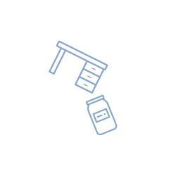

# deskjam

## How this fork differs

This is a fork of [tinnus-napbus/deskjam](https://github.com/tinnus-napbus/deskjam). It adds support for installing and updating apps by uploading `.deskjam` files.

Apart from the security fixes below, everything upstream deskjam does still works the same way, and stays the default:

- Merging an upload into an existing desk still writes its files and keeps the desk's other files. It's still the default, except for an app update: then deskjam selects **Replace** (see below).
- New desks still start suspended.
- Downloads, subsets and url uploads still work.
- The old form fields and the old `%new-desk` and `%add-files` pokes still work.

New, and opt-in:

- **Replace**: update a desk so it becomes exactly the upload. Files the upload lacks are deleted, so files a new version of an app removed or renamed don't linger. deskjam selects it for an app update: an upload that is a whole app, with its own `/sys/kelvin` and `/desk/bill`, and has an existing desk's name.
- **Start after upload**: optionally `|revive` the desk in the same commit.
- **Stop kiln syncing**: optionally `|pause` a desk that kiln overwrites from a publisher, so their updates don't undo yours. This stops all their updates, not just the next one.
- **Serve the glob from your ship**: for an app with a glob, set the glob's hash in its docket as you upload, so the app's repo doesn't need the hash of every frontend build. See [Apps with globs](docs/globs.md).
- **Allow local addresses**: url uploads refuse addresses on your ship's machine and local network unless you tick this.

New, and always on:

- **A fuller confirm page**: before committing, it lists the files that will be deleted, added, changed and left alone, and checks the upload against what Clay will do. It refuses only commits Clay would reject or ignore anyway, plus replacing `%base` or `%kids` and replaces that would stop a desk's agents. Everything else, including desks that are synced from elsewhere, gets a warning.
- **A status page**: after each commit, it says whether the upload landed and whether the desk is running. The index page can show any desk's status.
- **Url uploads**: they follow redirects and send escapes like `%20` as written, so GitHub release links work. When a fetch fails, they say why.

It also fixes these security problems. These fixes are always on:

- **Forms from other websites are refused.** Upstream accepts a form submission from any web page you visit while logged in to your ship. A malicious page could have your browser upload a desk, or have your ship fetch one from the attacker's server, and commit it, even into a running desk. deskjam now answers 403 when the browser says a submission came from a page on another origin. Browsers say so in `Sec-Fetch-Site` to https and localhost addresses. Over plain http, and in browsers from before 2023, they send only `Origin`, which then has to match the address you reached your ship at. Requests with neither header, such as from `curl` or scripts, work as before.
- **No event stream for other ships.** Upstream wraps the agent in the `verb` library, which lets any ship subscribe to a stream of deskjam's events. The stream shows when you use deskjam and the names of the desks you upload to. This fork drops `verb`, so `:deskjam +verb` no longer works either, and ends existing subscriptions when it loads.
- **Crafted files can't hang your ship.** deskjam unpacks a file, and reads its `/desk/bill`, `/desk/docket-0` and `/sys/kelvin`, before you confirm anything. A crafted file could unpack to something exponentially larger than itself, or make those files compute forever, and the ship would hang while showing the upload. deskjam now refuses a file that unpacks to far more than its size. It reads those three files with its own reader, which takes only the plain values real files use and doesn't run Hoon's parser, and it lists only as many of an upload's files as a page can show quickly.
- **Links can't put words in deskjam's mouth.** A link to deskjam with `?rmsg=` in it showed that text as a green deskjam notice, on the pages that install code. deskjam now only shows its own notices.
- **Url uploads stay off your network.** They refuse urls on your ship's own machine or local network, such as routers or the ship's own ports, and redirects to them, unless you tick **allow local addresses**. A host name that only resolves to a local address still gets through, as only the runtime looks names up.

If you reach your ship over plain http through a reverse proxy that changes the `Host` header, the proxy has to tell your ship the address the browser used. Otherwise deskjam refuses its own forms, with a message that says so. Passing on the browser's `Host` works (in nginx, `proxy_set_header Host $http_host;`), and so does an `X-Forwarded-Host` header, which Apache adds by default, or `Forwarded: host="..."`.

The tile icon is part of the docket, url-encoded, where upstream's comes from a web server. deskjam only reaches outside your ship when you upload from a url.

See [Installing and updating apps](#installing-and-updating-apps) for details, and [Replacing upstream deskjam](#replacing-upstream-deskjam) to switch to this fork.

## Building

You can build the full `%deskjam` desk with the [`mortar` build tool available here](https://github.com/tinnus-napbus/mortar). It writes the desk to `dist`.

Or, with Nix with flakes enabled, run `nix build`, which writes the same desk to `result`. `flake.nix` pins the same dependencies as `mortar.yaml`, so change them together. Nix only sees files git knows about, so after adding a file to `desk`, run `git add` (or any `jj` command, such as `jj status`) before `nix build`.

The app's tile icon, [`assets/deskjam.svg`](assets/deskjam.svg), is a copy of upstream's. `desk/desk.docket-0` carries it url-encoded, as a `data:` URL, so Landscape shows it without loading anything, including in previews on other ships before they install deskjam. After changing the icon, replace the URL in the docket's `image` with the output of this, run in the repo: `python3 -c 'import urllib.parse as u; print("data:image/svg+xml," + u.quote(open("assets/deskjam.svg").read(), safe=""))'`. `nix build` checks that the two match.

### Testing

`nix flake check` builds the desk, checks that `mortar.yaml` pins the same files at the same revisions as `flake.nix`, and runs the Hoon tests in [`tests/hoon`](tests/hoon) with `urbit eval`. Those cover the url handling, the cross-site check and the upload guards, and need no ship. To run just them: `nix shell --inputs-from . nixpkgs#urbit -c tests/hoon/run.sh`.

[`tests/fakezod`](tests/fakezod) boots a fake ship, installs your working copy of deskjam on it, and drives its web interface with curl. Its `smoke-test.sh` uploads, installs and replaces a test app. See its [README](tests/fakezod/README.md).

CI runs `nix flake check` on every push, and the fake-ship test on pull requests.

## Installation

`~donmec-sallud` publishes this fork. To install it, run `|install ~donmec-sallud %deskjam` in the dojo. Your ship then gets deskjam's updates from that ship. [shelf.iko.soy](https://shelf.iko.soy) lists all the apps `~donmec-sallud` offers.

To install it from this repo instead:

1. Clone this repo: `git clone https://github.com/iko-soy/deskjam`.
2. Boot up a ship (fakezod or moon or whatever you use).
3. `|new-desk %deskjam` to create a new desk called `%deskjam`.
4. `|mount %deskjam` to access the `%deskjam` desk from the unix command line.
5. At the unix command line `rm -rf [ship-name]/deskjam/*` to empty out the contents of the desk.
6. In the repo, run `mortar build`, or `nix build`.
7. Copy the contents of `dist` to `[ship-name]/deskjam`. After `nix build`, copy `result` instead, and make the copies writable, since files Nix builds are read-only. From the repo: `cp -R result/. /path/to/[ship-name]/deskjam/ && chmod -R u+w /path/to/[ship-name]/deskjam`.
8. At the dojo command line `|commit %deskjam`.
9. Install with `|install our %deskjam`.

### Replacing upstream deskjam

If your ship already runs upstream deskjam, you can install this fork through it, without access to the ship's files:

1. Get this fork as a deskjam: in a clone of this repo, run `nix build`, then `tests/fakezod/pack.sh result deskjam deskjam.deskjam`, as [Deploying an app](docs/deploying.md#1-pack-the-desk) says. Or download the `%deskjam` desk from `[your-domain-name]/apps/deskjam` on a ship that runs this fork.
2. On your ship, run `+vats %deskjam` in the dojo. If its source ship isn't `~`, kiln keeps it in sync with the ship you installed it from, and that ship's next release would replace the fork. Run `|pause %deskjam` first.
3. Upload the deskjam on `[your-domain-name]/apps/deskjam`. On the next page, under **Stage a desk to merge with**, choose `deskjam`: the list starts on whichever desk comes first, not on `%deskjam`. Submit, check that the confirm page names `%deskjam`, then confirm.

This drops any upload you had staged but not yet committed. To install a later version of this fork, upload it the same way and choose **Replace**.

### Kernel updates

This section is for a deskjam you installed from this repo or uploaded: one installed from `~donmec-sallud` gets new versions from that ship instead.

When Urbit releases a new kernel, your ship suspends every desk whose `sys.kelvin` doesn't list it, and a suspended deskjam can't upload its own update. So before your ship takes a new kernel, install a version of this fork that lists it: get it as a deskjam, as in step 1 above, then upload it with deskjam and choose **Replace**. It still lists your current kernel too, so Clay applies it right away, and deskjam keeps running through the upgrade.

If your ship has already upgraded, `|revive %deskjam` won't work. Install the new version as in [Installation](#installation), steps 4 to 8, and Clay starts deskjam again.

## Usage
1. To download a desk as a deskjam, go to `[your-domain-name]/apps/deskjam`, choose the desk under **download deskjam**, and click **download**.
2. To download some of a desk's files, check **subset** first, then choose the files.
3. To see a desk's status, choose it there and click **status**.
4. To install or update an app, or upload a jammed desk, go to `[your-domain-name]/apps/deskjam` and follow the instructions there. See [Installing and updating apps](#installing-and-updating-apps).

## Installing and updating apps

Only upload deskjams from people you trust: an app's agents run as your ship, and can read and change anything on it.

[Deploying an app](docs/deploying.md) walks through the simplest way to put an app on your ship, deskjam itself included: pack its desk with `tests/fakezod/pack.sh`, then upload it here.

Upload a deskjam on `[your-domain-name]/apps/deskjam`, from a file or a url. The next page describes the upload (its app, kernel version and agents) and asks where it should go:

- **Install it as a new desk.** New desks start suspended, as with `|new-desk`. On the confirm page you can tick "start its agents after uploading", which does what `|revive` does.
- **Update an existing desk**, in one of two ways:
  - **Merge** writes the upload's files and leaves the desk's other files in place.
  - **Replace** makes the desk exactly the upload: files the upload lacks are deleted. Use this to update an app, so files a new version removed or renamed don't linger.

  deskjam selects **Replace** when the upload is a whole app, with its own `/sys/kelvin` and `/desk/bill`, and has the name of an existing desk, as an app update does. For any other upload, it selects **Merge**.

Every upload is a single Clay commit. When the desk is running, Clay rebuilds its agents as part of that commit and reloads those whose code changed. If a file or agent fails to build, or a running agent fails to load its state, Clay rejects the whole commit. The desk stays as it was, the browser shows an error, and your ship's dojo shows why. (An agent that is new to the desk and crashes as it starts doesn't stop the commit.)

Before you confirm, deskjam lists the files it will delete, add and change, the files that stay the same, and for a merge the files it leaves in place. Files it can't compare, because it doesn't know how their mark stores them, are listed as files that may change. Files that stay the same are left out of the commit. It also checks the upload. Apart from `/sys/kelvin` files it can't read, it only refuses what Clay would reject or ignore anyway:
- a desk without `/sys/kelvin`, or a kelvin no kernel can use;
- a `/sys/kelvin` that doesn't write its kernels out as plain values, such as `[%zuse 408]`, which deskjam won't evaluate;
- a file with no mark to convert it, or with an empty path;
- a file whose mark needs a file the desk would lack: a library or another file it imports, or the mark it hands its diffs to;
- a running desk whose `/desk/bill` would list an agent it has no `/app` file for, or an agent twice, or whose agents or marks need a file it would lack.

deskjam finds what a mark or agent needs by reading the imports at the top of each file, as Clay does. It doesn't compile anything, so a file with a type error still only shows up when Clay refuses the commit.

It also refuses two things only the new replace option could do: replacing `%base` or `%kids`, or dropping a desk's `/desk/bill` and so stopping all its agents. Everything else is a warning:

- When the upload's agents already run from another running desk. Committing it to a running desk moves them over, state and all, and every later commit to `%base`, including your sponsor's updates, then fails with `cannot run app from two desks` until one of the two desks stops listing them. (Kernels before 408k-2 reject the commit instead.) deskjam won't offer to start a desk in that state.
- When the upload's `/desk/bill` drops agents the desk runs now, which Gall then stops.
- When a desk that isn't running would lack a file its agents or marks need, or lists an agent twice, so Clay couldn't start it.
- When library, thread or generator files import files the desk would lack, so they won't build if anything uses them.
- When `.json` files aren't valid JSON, which the standard json mark stores as null.
- When a suspended desk holds the saved state of agents named like the upload's. Gall gives that state to the upload's agents when they start.
- When the upload is built for a different kernel than your ship runs. If it only supports newer kernels, Clay holds it until your ship upgrades, and nothing changes now. For `%base`, deskjam applies Clay's rules for kernel updates and says whether the commit would change your ship's kernel right away or wait.
- When the desk is overwritten from outside: kiln keeps it in sync with another desk, as with an app installed with `|install ~publisher %desk`, or copies another desk's updates into it, as with `%kids` and `%base`. The source's next update would undo yours. Tick "stop kiln syncing" to do what `|pause` does. That stops all of the source's updates, and kiln forgets where the desk came from; the confirm page gives the `|install` command that turns them back on. The desk list on the staged page marks synced desks, and the status page warns again after a commit if the sync is still on.
- When the app's frontend would go missing: because the upload changes the hash of a glob your ship serves, or because a suspended desk that serves its glob from your ship starts again. See [Apps with globs](docs/globs.md).
- When the docket's glob url can't be read, when it has your ship serve the glob but its base isn't the desk's name, and when the upload is an older version than the desk has.
- When the upload changes nothing, when merging would leave files behind, when the upload is a copy of a differently named desk, and when merging into `%base`.

The confirm page only commits what it showed you. If the upload, its destination or the desk changed since, in another tab or by a commit or a kiln update, it asks you to check again.

After the commit deskjam shows the desk's status. That covers its revision, whether it is running, its agents, the kernel it is for, its glob, whether kiln syncs it, and whether the upload made a new revision. If the upload matched what the desk already had, or Clay is holding it for a newer kernel, there is no new revision. If the desk should have started but didn't, the status page says so, and if it was left suspended, how to start it.

Url uploads follow redirects and send escapes like `%20` as written (the runtime on its own would decode them), so links to GitHub release assets work. Link to the file itself, not to a page about it. A fetch gives up after 10 minutes, and stops when you go back to the start page. If it fails, the staged page says why. Urls on your ship's machine or local network are refused unless you tick **allow local addresses**.

### Apps with globs

An app's web frontend, its glob, isn't part of its desk: Landscape's `%docket` agent fetches it as the desk's docket says. For an app that serves its glob from your ship, the confirm page can set the glob's hash in the docket, so the app's repo doesn't need it. [Apps with globs](docs/globs.md) has the whole procedure.

### If an update goes wrong

Before confirming an update, the confirm page offers a download of the desk as it is now. Keep it: uploading it again and choosing **Replace** puts the desk back. That doesn't work for `%base` and `%kids`, which deskjam won't replace.

Putting an older version back usually fails safely when the update changed the state an agent keeps: the old agent can't load the new state, so Clay refuses the commit, and nothing changes. But an agent that starts afresh from state it can't read, as deskjam itself does, loses that state instead. If the update changed the hash of a glob your ship serves, also upload the old frontend at `/docket/upload`.
